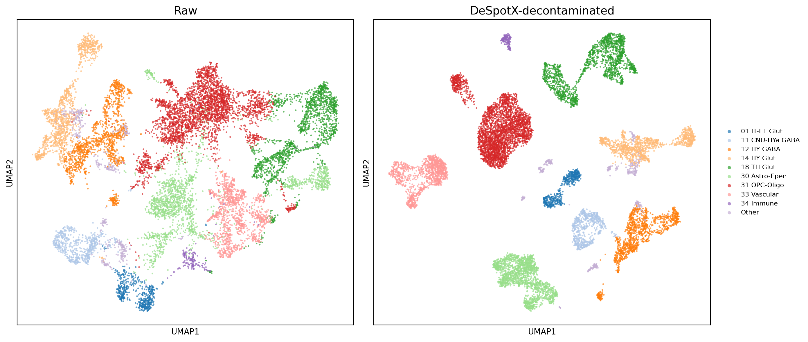

# DeSpotX

DeSpotX, a deep generative model for single-cell spatial transcriptomics decontamination.


## Install

The fastest way is a one-shot conda environment that pulls all pinned
dependencies and installs DeSpotX itself:

```bash
git clone https://github.com/Gentles-lab/DeSpotX.git
cd DeSpotX
conda env create -f environment.yml
conda activate despotx
```

This installs the `despotx` CLI and importable Python package. Verify with:

```bash
despotx --help
```

For GPU support, edit `environment.yml` to use the CUDA-matching pytorch
build (e.g. `pytorch=2.11.0=*cuda*`) before `conda env create`.

### Alternative: build a conda package locally

```bash
conda install -c conda-forge conda-build
conda build conda-recipe/
conda install --use-local despotx
```

### Alternative: pip from source

```bash
pip install .
# or for development: pip install -e .
```

## Quickstart with example data

A ~12,000-cell × 550-gene MERFISH brain subset (raw, single tissue
sub-region, 25 cell types) ships in `example_data/`:

- `merfish_brain_example.h5ad` — cell-type labels in
  `obs.cell_type_manual`, spatial coordinates in `obsm["spatial"]`.

Run DeSpotX:

```bash
despotx \
    --h5ad example_data/merfish_brain_example.h5ad \
    --cell-type-col cell_type_manual \
    --spatial-key spatial \
    --out example_output/ \
    --device cuda
```

After decontamination, UMAP shows tighter, better-separated clusters:


