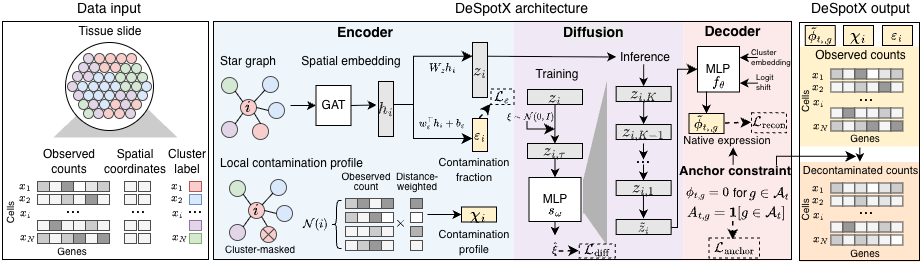
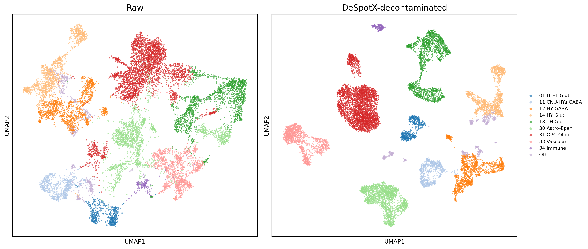

# DeSpotX

DeSpotX, a deep generative model for single-cell spatial transcriptomics decontamination.



## Install

### Use conda environment

```bash
git clone https://github.com/Gentles-lab/DeSpotX.git
cd DeSpotX
conda env create -f environment.yml
conda activate despotx
```

This installs the `despotx` CLI and importable Python package. Verify with:

```bash
despotx --help
```

For GPU support, edit `environment.yml` to use the CUDA-matching pytorch
build (e.g. `pytorch=2.11.0=*cuda*`) before `conda env create`.

### Alternative: build a conda package locally

```bash
conda install -c conda-forge conda-build
conda build conda-recipe/
conda install --use-local despotx
```

### Alternative: pip from source

```bash
pip install .
# or for development: pip install -e .
```

## Quickstart with example data

A ~12,000-cell × 550-gene MERFISH brain subset (raw, single tissue
sub-region, 25 cell types) ships in `example_data/`:

- `merfish_brain_example.h5ad` — cell-type labels in
  `obs.cell_type_manual`, spatial coordinates in `obsm["spatial"]`.

Run DeSpotX:

```bash
despotx \
    --h5ad example_data/merfish_brain_example.h5ad \
    --cell-type-col cell_type_manual \
    --spatial-key spatial \
    --out example_output/ \
    --device cuda
```

This writes the following files to `example_output/`:

| File | Contents |
|---|---|
| `adjusted.h5ad` | Decontaminated AnnData. `.X` holds the corrected counts (cells × genes); `obs["epsilon"]` is the per-cell ambient fraction. |
| `adjusted.mtx` | Same corrected counts in MatrixMarket format (genes × cells), for tools that don't read AnnData. |
| `adjusted_float.npy` | Same corrected counts as a (cells, genes) float32 NumPy array. |
| `anchor_mask.npy` | (cell_type, genes) boolean array marking the anchor positions used during training. |
| `genes.tsv` | One gene name per line, in column order of the matrices. |
| `cells.tsv` | One cell barcode per line, in row order. |
| `contamination.tsv` | Two columns: `cell_id` and the predicted per-cell ambient fraction `contamination` (= ε). |

Plot side-by-side UMAP of raw vs decontaminated counts (requires `scanpy`):

```bash
python scripts/plot_umap.py \
    --raw example_data/merfish_brain_example.h5ad \
    --adjusted example_output/adjusted.h5ad \
    --cell-type-col cell_type_manual \
    --out example_output/umap_raw_vs_despotx.png
```

After decontamination, UMAP shows tighter, better-separated clusters:


